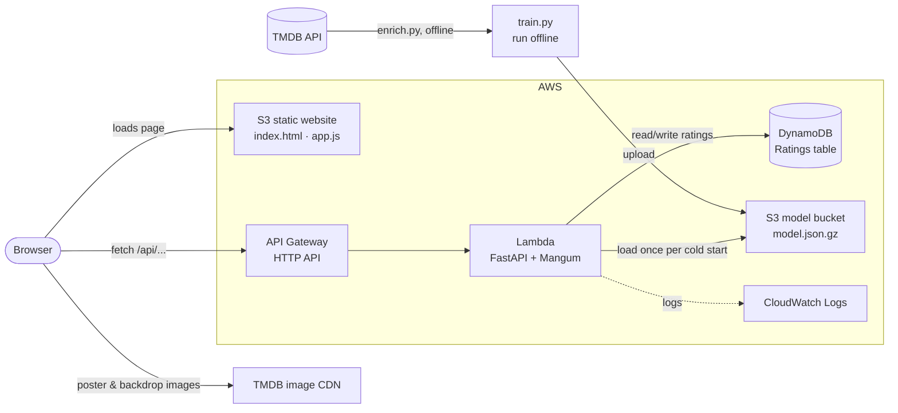

# Architecture

## What each AWS service does

| Service | Role in this project | Why this choice |
|---|---|---|
| **S3 (website bucket)** | Hosts the HTML/CSS/JS page as a static website. | No server needed for static files; pennies per month. |
| **API Gateway (HTTP API)** | Public HTTPS endpoint; forwards every `/api/...` request to Lambda. | Managed, scales automatically, free tier covers 1M requests/month. |
| **Lambda** | Runs the Python API (FastAPI wrapped by Mangum). | Pay per request, no idle cost, no servers to patch. |
| **DynamoDB** | Stores each user's ratings (`userId` partition key, `movieId` sort key). | Serverless key-value store; "get all ratings of one user" is a single query. |
| **S3 (model bucket)** | Holds the trained model file, private. | Decouples training from serving: retrain and re-upload without redeploying code. |
| **IAM** | The Lambda role may only use *this* table and read *this* bucket. | Least privilege. |
| **CloudFormation / SAM** | `template.yaml` creates all of the above in one command. | Infrastructure as code: repeatable, reviewable, deletable. |
| **CloudWatch Logs** | Lambda logs, automatically. | Debugging in production. |

## Local vs AWS

The same code runs in both places; only environment variables change.

| Piece | Locally | On AWS |
|---|---|---|
| Website | served by uvicorn from `frontend/` | S3 static website |
| API | `uvicorn app.server:app` | Lambda `app.server.handler` behind API Gateway |
| Ratings | DynamoDB Local (official Amazon Docker image) | DynamoDB |
| Model | `model/model.json.gz` on disk (`MODEL_PATH`) | S3 (`MODEL_S3_BUCKET`), cached in `/tmp` |

## Movie details and images

`enrich.py` runs once on the developer's machine. It looks up each MovieLens movie on TMDB (MovieLens ships the TMDB id in `links.csv`), keeps only what the site shows (poster and backdrop paths, overview, tagline, runtime, director, top-5 cast) and `train.py` folds that into the model file. The browser then loads images straight from TMDB's image CDN.

Keeping this offline means the TMDB key never leaves the developer's machine, the Lambda makes no third-party calls (fast, nothing to rate-limit) and there is still nothing to change in the AWS setup.

## Users

There are no accounts. The website generates a random id on first visit, keeps it in `localStorage`, and uses it as the DynamoDB partition key for that visitor's ratings. "Start over" on the ratings page just generates a new id.

## How the recommendations work

1. **Offline training** (`train.py`, MovieLens: 9,742 movies, 100,836 ratings by 610 users):
   - *Content similarity:* each movie becomes a TF-IDF vector of its genres and user tags; cosine similarity between vectors.
   - *Collaborative similarity:* each movie becomes a vector of (mean-centred) ratings from every user; cosine similarity — "people who rated this highly also rated that highly". Only movies with ≥ 10 ratings take part.
   - *Hybrid:* `0.5 × content + 0.5 × collaborative`. Only the top 30 neighbours per movie are kept, so the model is ~1 MB instead of a 9,742 × 9,742 matrix.
   - *Popular list:* Bayesian average rating, so a film with two 5★ ratings doesn't beat one with hundreds of 4.5★.
2. **Serving** (`app/recommender.py`): for every movie the user rated, weight = rating − 3 (5★ → +2, 1★ → −2). Each neighbour's score is the sum of weight × similarity. Already-rated movies are removed; the biggest contributor becomes the "Because you liked …" reason. Users with no positive ratings get the popular list (cold start).

Because the heavy maths happens offline, the Lambda only needs FastAPI, Mangum and boto3 (34 MB package; Lambda's limit is 250 MB) and answers in milliseconds.
